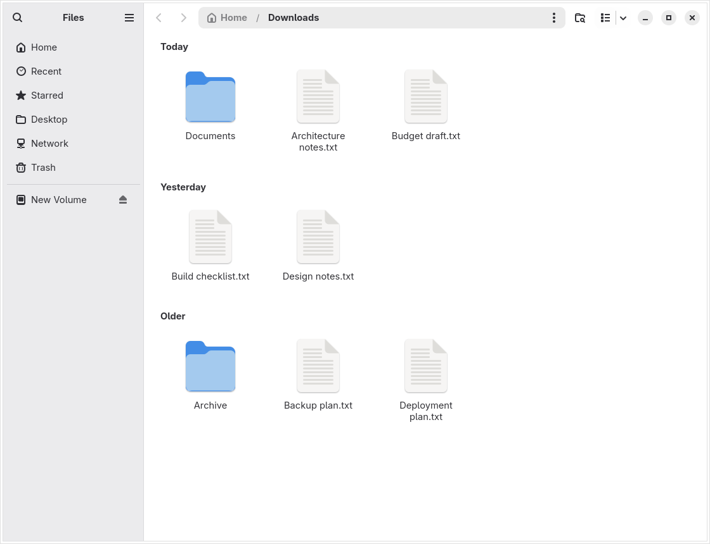
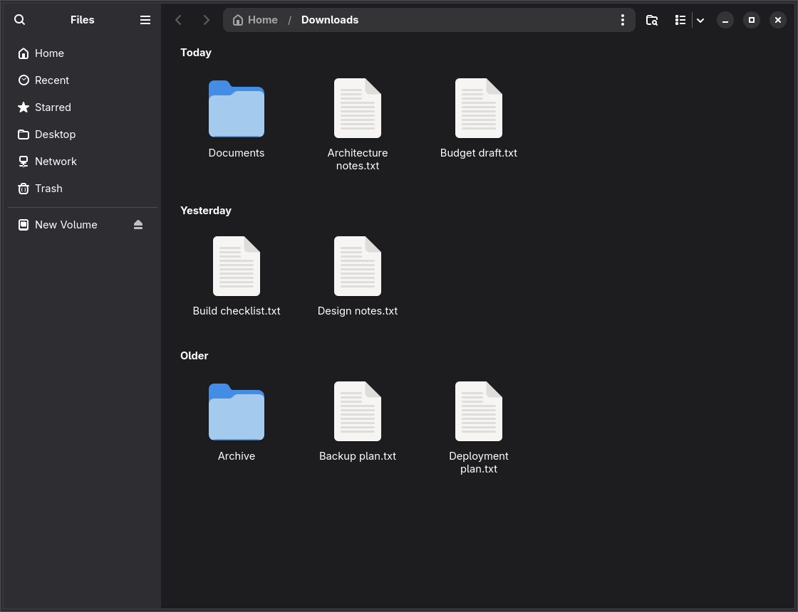
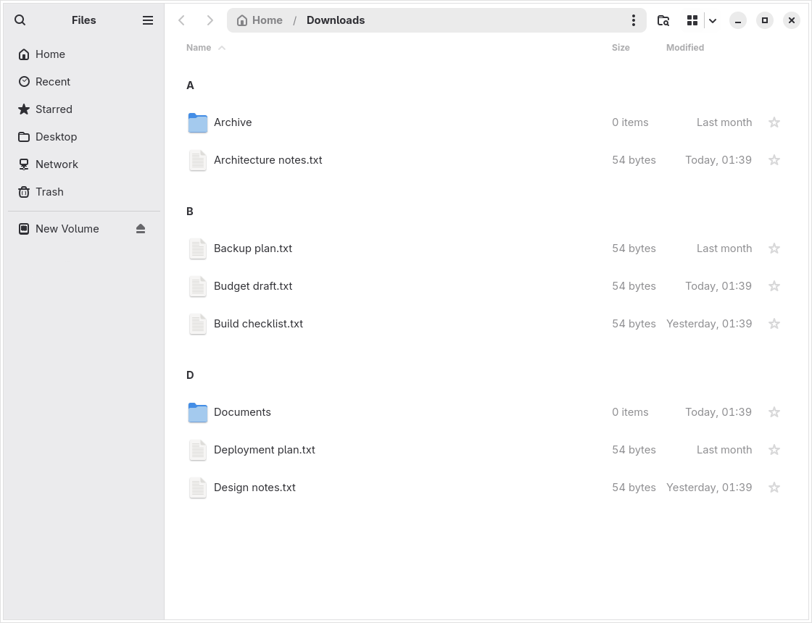
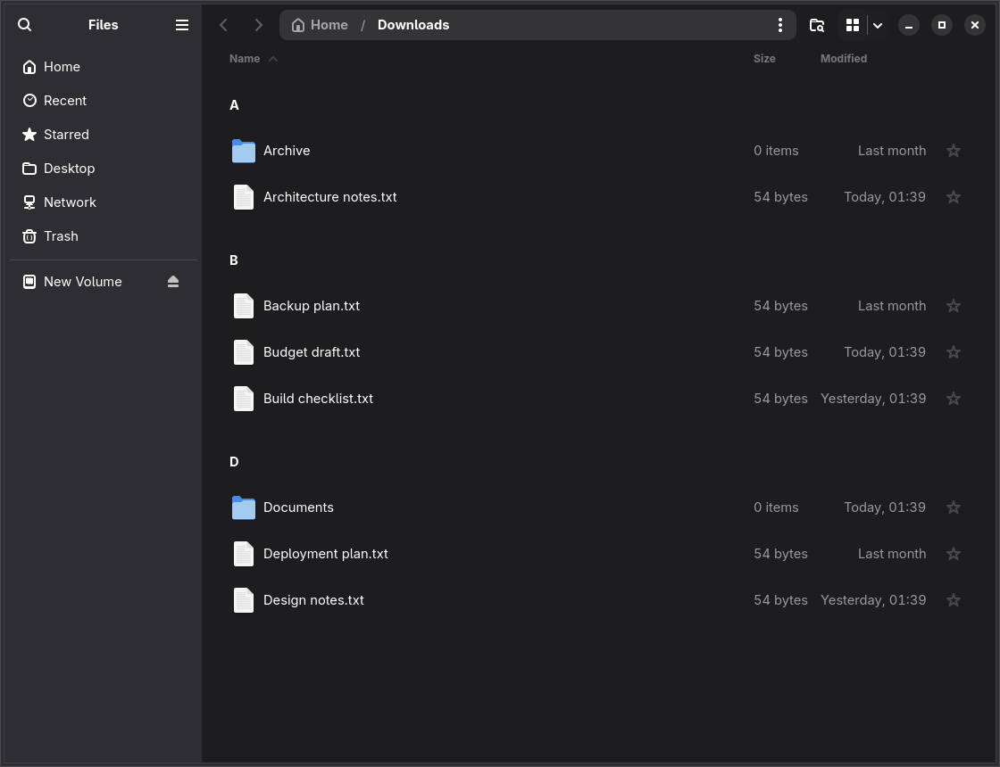

# Nautilus Extended

A downstream fork of Nautilus 51.1 for Arch/CachyOS, with per-folder grouping, type-ahead navigation, and other usability improvements.
> [!WARNING]
> **AI disclosure**
>
> This fork vibe-coded. AI agents wrote nearly all of the new downstream feature code, and AI agents reviewed it.
>
> Read it, review it, run it, and fork it as such: expect bugs.


## Features

- Type-ahead filename navigation, including repeated-initial-letter cycling and prefix searches.
- Backspace navigation to the parent folder.
- Per-folder **No Grouping**, **Group by Time**, and **Group by Name (A-Z)** choices in View Options.
- Group headings in icon and list views, including Nautilus's own portal file chooser.
- Folders-before-files within each section when that preference is enabled.

Downloads defaults to time grouping. Other folders remain ungrouped until enabled. Empty sections are hidden; section headings are not collapsible.

Time grouping normally uses **last-modified time**, not a recorded download date. Selecting a creation-time or access-time sort uses that timestamp instead. Name sections always have ascending initial-letter order; the existing Sort control still orders files within each section.

This does not modify native GTK/KDE file pickers supplied by other chooser backends.

## Screenshots

Full-window captures of the patched application using example files, in light and dark mode.

### Time grouping - icon view

<table>
	<tr>
		<th>Light mode</th>
		<th>Dark mode</th>
	</tr>
	<tr>
		<td></td>
		<td></td>
	</tr>
</table>

### Name grouping - list view

<table>
	<tr>
		<th>Light mode</th>
		<th>Dark mode</th>
	</tr>
	<tr>
		<td></td>
		<td></td>
	</tr>
</table>


## Build and install

Review `PKGBUILD` and the patches before building. On an Arch-based system with the usual packaging tools:

```sh
makepkg -si
```

The package replaces the distribution's Nautilus package. Restart Nautilus after installation when it is safe to close its windows.

The project is named **Nautilus Extended**. The Arch packages retain the names `nautilus-typeahead` and `libnautilus-extension-typeahead` for compatibility with existing installations.

To extract the patched source for inspection without building a package:

```sh
makepkg -o
```

The source is under `src/nautilus/`. Patch files are generated diffs, not the source modules themselves.

The 51.1 build also fetches the pinned `libgxdp` Git source required by Nautilus's portal integration. `MESON_PACKAGE_CACHE_DIR` points Meson at that verified source rather than letting it fetch an untracked subproject during the build.

## Source organization and patches

The package applies numbered patches in order. The original Backspace and type-ahead restoration patches are followed by a series separating shared grouping/list support, the grouped icon view, and the incremental type-ahead integration. Apply the complete series in the order listed by `PKGBUILD`.

Preparation applies only patches declared in `source[]`, in that order. Old patch files or links left in a reused `src/` directory are ignored; they must not be discovered through a wildcard.

The extracted Git checkout is disposable build state. Preparation removes only leftover untracked paths that the declared patches create, then applies the series with `git apply --index`. This lets makepkg's next forced checkout remove patch-added files as well as reset modified files, so consecutive builds can reuse `src/`. Unrelated untracked files are not cleaned.

The downstream additions are generated from three logical commits:

1. [`0003`](0003-Add-per-folder-grouping-policy-and-list-sections.patch): grouping policy, per-folder controls, list sections, and their regressions.
2. [`0004`](0004-Add-virtualized-grouped-icon-view.patch): virtualized grouped icons, the row model/controller, and grid regressions.
3. [`0005`](0005-Cycle-typeahead-matches-in-display-order.patch): display-order type-ahead integration and cycling regressions.

This is an organizational refactor, not a claim that the feature needs little code. The grouped icon controller remains substantial because it owns keyboard, pointer, selection, drag-and-drop, and scrolling behavior that GTK's grid widget does not provide for sections.

In the prepared Nautilus source:

| Module | Responsibility |
| --- | --- |
| `src/nautilus-file-grouping.c` | Time/name classification, group ordering, calendar boundaries, and heading titles |
| `src/nautilus-grid-row-model.c` | Virtualized icon-row geometry and mappings between row/cell and file positions |
| `src/nautilus-grouped-grid.c` | Grouped icon rendering, selection, keyboard/pointer interaction, and scrolling |
| `src/nautilus-list-base.c` | Shared view lifecycle, model integration, and live heading bindings |
| `src/nautilus-grid-view.c` | Native icon-view setup and delegation to the grouped view |

Maintain source changes as small commits against the Nautilus version named in `PKGBUILD`, then generate patches from those commits. Do not split patches by cutting arbitrary diff hunks: later changes can depend on earlier context. Verify the complete series on a clean source tree and update its checksums and `.SRCINFO` together.

## Reporting issues

Report issues in the [Nautilus Extended issue tracker](https://github.com/Not-Dhanraj/nautilus-extended/issues). Do not report downstream-only problems to upstream Nautilus unless they reproduce without these patches.

Include:

- Package and Nautilus versions.
- Distribution and GTK version.
- Icon/list view, grouping mode, and relevant sort settings.
- Exact reproduction steps, expected behavior, and observed behavior.
- A minimal example or screenshot where useful; redact private paths and filenames.

Human review, reproducible bug reports, and fixes are welcome.
