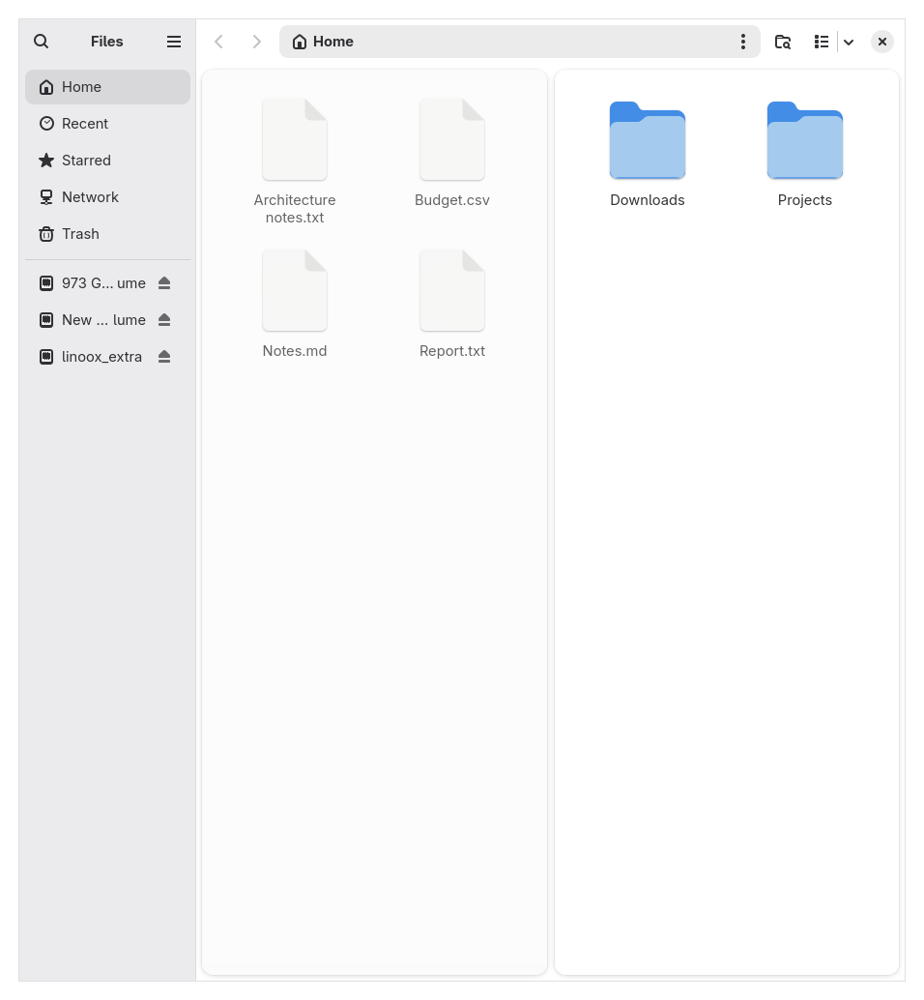
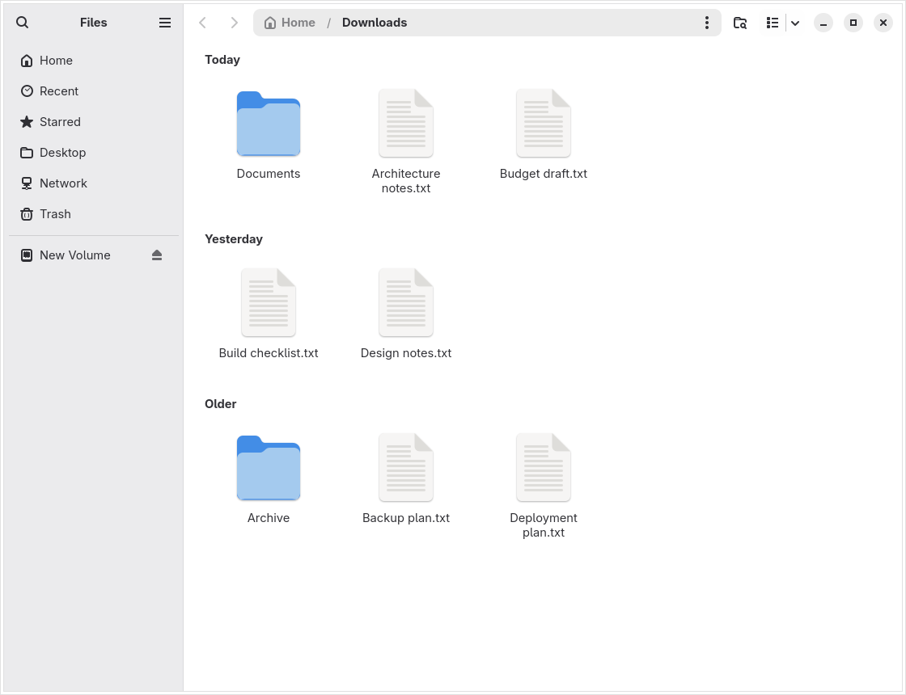
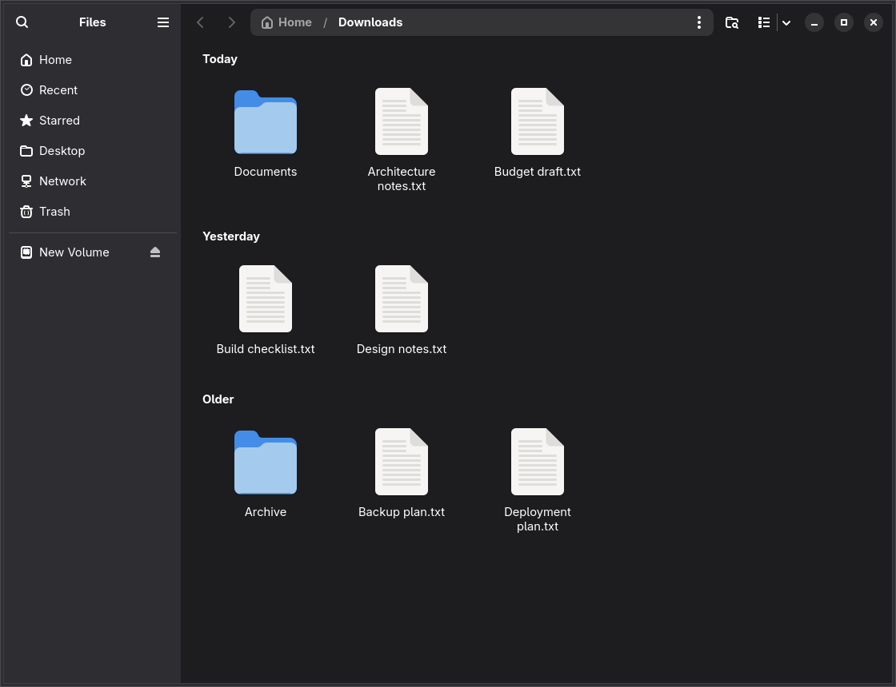
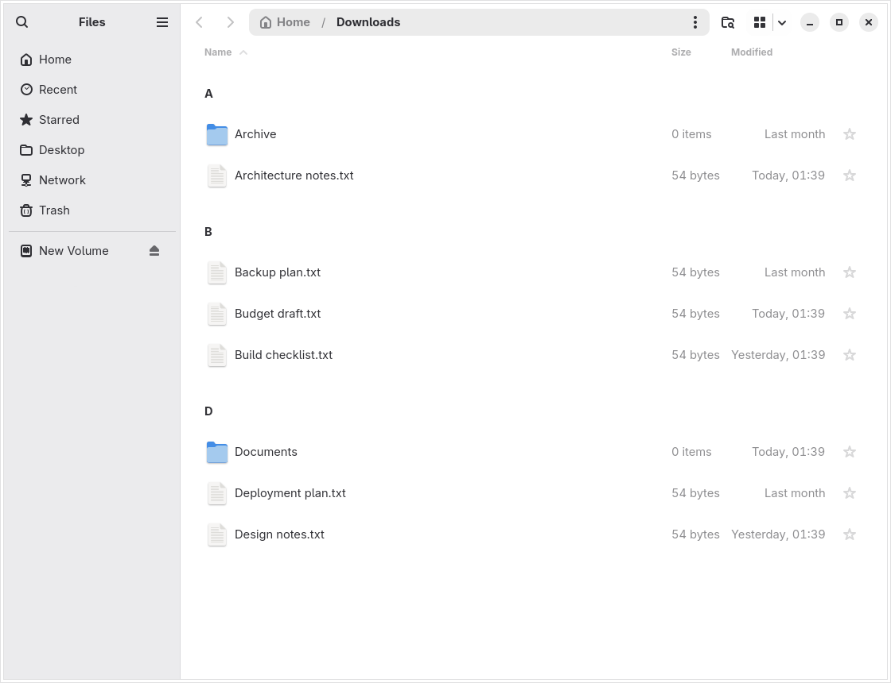
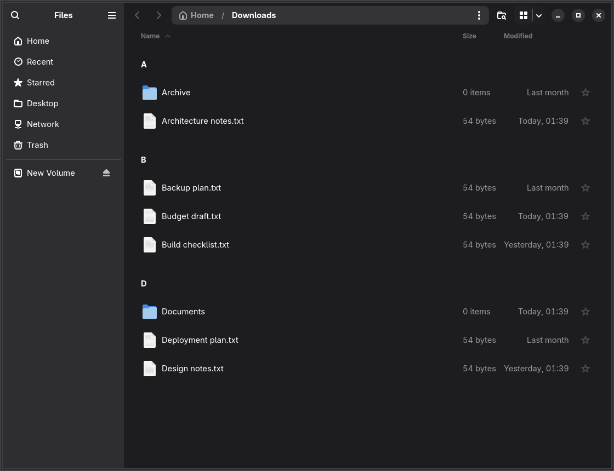

# Nautilus Extended

A downstream fork of Nautilus 51.1 for Arch/CachyOS, with per-folder grouping, type-ahead navigation, and other usability improvements.
> [!WARNING]
> **AI disclosure**
>
> This fork vibe-coded. AI agents wrote nearly all of the new downstream feature code, and AI agents reviewed it.
>
> Read it, review it, run it, and fork it as such: expect bugs.


## Features

- Type-ahead filename navigation, including repeated-initial-letter cycling and prefix searches.
- Configurable Backspace navigation: parent folder (default) or previous location in history.
- Per-folder **No Grouping**, **Group by Time**, and **Group by Name (A-Z)** choices in View Options.
- Group headings in icon and list views, including Nautilus's own portal file chooser.
- Folders-before-files within each section when that preference is enabled.
- Native GTK selection styling in grouped icon views.
- Optional fresh windows for locations opened by other applications.
- Native per-tab dual pane with F3, shared navigation controls, and a standard divider.
- Independent monochrome bookmark icons, with Change/Reset controls in local bookmark context menus.

Downloads defaults to time grouping. Other folders remain ungrouped until enabled. Empty sections are hidden; section headings are not collapsible.

Time grouping normally uses **last-modified time**, not a recorded download date. Selecting a creation-time or access-time sort uses that timestamp instead. Name sections always have ascending initial-letter order; the existing Sort control still orders files within each section.

This does not modify native GTK/KDE file pickers supplied by other chooser backends.

Enable **Open External Locations in a New Window** in Preferences to keep browser
“Open Downloads”, external file reveals, and command-line opens out of existing
windows. It is off by default; internal navigation and New Tab actions are unchanged.

```sh
gsettings set org.gnome.nautilus.preferences open-external-in-new-window true
```

Choose **Preferences → General → Backspace Action** to switch between **Parent
Folder** and **Previous Location**. Changes apply immediately to existing windows;
Backspace still edits text normally in text fields.

```sh
gsettings set org.gnome.nautilus.preferences backspace-action 'history-back'
# Restore the default:
gsettings reset org.gnome.nautilus.preferences backspace-action
```

### Custom folder icons

Use **Properties → click the folder icon** to choose a supported local image,
including PNG or SVG. The existing Glycin image validation and invalid-image
feedback are preserved. This changes the main folder image, not its bookmark
symbol. Closing Properties also closes an outstanding icon picker.

### Custom bookmark icons

Sidebar bookmarks keep their normal symbolic icons even when the folder has a
full-colour custom PNG. To change just a local bookmark's symbol, right-click it
and choose **Change Bookmark Icon…**, then select a local `*-symbolic.svg` file.
The chooser validates the SVG before saving it. **Reset Bookmark Icon** appears
when an override exists and restores the default without changing the folder icon.

For this icon collection, choose a file such as
`~/misc/icons/symbolic/research-symbolic.svg`. The original purple folder
PNG can remain assigned through Properties; the two settings are independent.
Symbolic SVGs use outlined paths so GTK recolouring preserves their line work.

Both **Select Custom Icon** in Properties and the bookmark icon picker use
Nautilus's own `NautilusFileChooser`, the same component used by the portal.
They share custom folder images, bookmark symbols, normal view-mode/grid-zoom
preferences, and saved chooser window dimensions. The bookmark picker preselects
the current icon; Properties starts in the folder being edited. Neither changes
global portal configuration. Copy/Move To and Extract To destination pickers are
unchanged by this icon-picker feature.

The sidebar-only URI is stored as `metadata::custom-symbolic-icon`. It is separate
from `metadata::custom-icon` and `metadata::custom-icon-name`, which still control
the main folder image. Menu changes update live; external `gio set` edits may
require restarting Nautilus to refresh cached metadata. Network bookmarks and
special sidebar locations retain their existing menus and symbols.

### Dual pane

- **F3** opens a second pane at **Home** the first time in the current tab, regardless of the active location. Press it again to hide the inactive pane and keep the active pane full-width; press F3 again to restore the hidden pane and its location and history.
- **F6** switches panes; **Tab / Shift+Tab** also switch while navigating the file canvas, without overriding text-entry traversal.
- **Click** either pane to activate it and move canvas focus with it; pointer hover does not switch panes. The click still reaches the file view for normal selection and folder navigation.
- **Ctrl+W** closes the focused pane when split and forgets its location and history; a later F3 opens a new pane at Home. Otherwise, Ctrl+W closes the current tab as usual.
- The tab close button closes both panes; **Ctrl+Shift+T** restores the complete closed tab and its histories.

The pathbar, sidebar, search, and view controls follow the active pane. Split views are floating Libadwaita islands with native shadows, 12px corners, a fixed 6px outer inset, and an 8px draggable center gap. There is no custom backdrop tint, painted center rule, extra headerbar, or duplicate close button. The active island uses the native elevated card surface; the inactive island recedes toward the window surface and its file content is dimmed to 75% opacity. Both islands resize proportionally with the window, with measured minimum sizes that keep them visible; single-pane mode returns to the normal edge-to-edge layout. Existing file drag-and-drop works between panes.

Split layout is retained within each tab during the running session, not across application restarts.

The [native palette comparison](assets/pane-hover-palette-a.png) remains the selected island styling. These images were captured before activation changed from hover to click; the [swapped island/window palette](assets/pane-hover-palette-b.png) is a comparison image only, not a shipped color mode.

## Screenshots

Full-window captures of the patched application using example files. The dual-pane capture shows the installed `51.1-18` release; grouping captures show light and dark modes.

### Dual pane



The active Home pane appears alongside the inactive Projects pane; shared controls follow the active pane.

### Time grouping - icon view

<table>
	<tr>
		<th>Light mode</th>
		<th>Dark mode</th>
	</tr>
	<tr>
		<td></td>
		<td></td>
	</tr>
</table>

### Name grouping - list view

<table>
	<tr>
		<th>Light mode</th>
		<th>Dark mode</th>
	</tr>
	<tr>
		<td></td>
		<td></td>
	</tr>
</table>


## Build and install

Review `PKGBUILD` and the patches before building. On an Arch-based system with the usual packaging tools:

```sh
makepkg -si
```

The package replaces the distribution's Nautilus package. Restart Nautilus after installation when it is safe to close its windows.

The project and Arch package base are named **Nautilus Extended** (`nautilus-extended`).
The split packages are `nautilus-extended` and `libnautilus-extension-extended`.
They replace the old `nautilus-typeahead` and `libnautilus-extension-typeahead`
packages; install both together and accept removal of the old names when prompted.
The executable remains `nautilus`, and the upstream library/API names remain
unchanged so existing Nautilus extensions continue to work.

For the older prebuilt `51.1-18` packages (without the latest fixes):

```sh
sudo pacman -U ./nautilus-extended-51.1-18-x86_64.pkg.tar.zst \
  ./libnautilus-extension-extended-51.1-18-x86_64.pkg.tar.zst
```

To extract the patched source for inspection without building a package:

```sh
makepkg -o
```

The source is under `src/nautilus/`. Patch files are generated diffs, not the source modules themselves.

The 51.1 build also fetches the pinned `libgxdp` Git source required by Nautilus's portal integration. `MESON_PACKAGE_CACHE_DIR` points Meson at that verified source rather than letting it fetch an untracked subproject during the build.

## Source organization and patches

The package applies a consolidated series of 11 logical patches in order. Rather than accumulating incremental bug fixes as follow-up patches, each logical feature folds its bug fixes, lifetime protections, and styling refinements directly into its feature owner. Apply the complete series in the order listed by `PKGBUILD`. (Note: a concurrent 7-patch consolidation proposal that altered divider/mouse semantics was evaluated and rejected; the maintained package preserves the verified 21-patch behavior byte-for-byte in the first 10 patches).

Preparation applies only patches declared in `source[]`, in that order. Old patch files or links left in a reused `src/` directory are ignored; they must not be discovered through a wildcard.

The extracted Git checkout is disposable build state. Preparation removes only leftover untracked paths that the declared patches create, then applies the series with `git apply --index --whitespace=error`. This lets makepkg's next forced checkout remove patch-added files as well as reset modified files, so consecutive builds can reuse `src/`. Unrelated untracked files are not cleaned.

The downstream additions are organized into 11 logical patches:

1. [`0001`](0001-Add-configurable-Backspace-navigation.patch): configurable Backspace navigation (parent folder by default or previous location in history), preferences UI, GSettings schema, live window action routing, and navigation regressions.
2. [`0002`](0002-Restore-typeahead-keyboard-navigation.patch): core typeahead keyboard navigation, query editor integration, slot/editor lifetime safety (safe input before first view, disconnect on slot disposal, repeated disposal protection), explicit selection provenance, and mount lookup cancellable ownership.
3. [`0003`](0003-Add-per-folder-grouping-policy-and-list-sections.patch): per-folder grouping policy and View Options controls, list sections, view-model section sorting, and same-mode calendar boundary refresh.
4. [`0004`](0004-Add-virtualized-grouped-icon-view.patch): virtualized grouped icon grid, row model and controller, RTL keypad Left/Right normalization, and documented owned first-row reference contract.
5. [`0005`](0005-Cycle-typeahead-matches-in-display-order.patch): grouping-aware display-order typeahead matching and cycling across sections. (Explicit dependency: builds on core typeahead in `0002` and visual grouping structures in `0003`/`0004` so cycling traverses visual display order rather than flat model order when grouped).
6. [`0006`](0006-Match-native-grouped-selection-styling.patch): native GTK selection styling parity in grouped icon views, separate from navigation policy.
7. [`0007`](0007-Open-external-locations-in-new-windows.patch): preference and window routing for locations opened by external applications.
8. [`0008`](0008-Add-native-per-tab-dual-pane-navigation.patch): complete production native per-tab dual pane: floating Libadwaita islands with native shadows (`overflow: visible`), 12px corners, 6px outer inset, 8px draggable gap, proportional resizing, measured minimum-width negotiation, focus and restore coherence, contextual Tab canvas switching, gettext translation extraction, and default secondary pane opening at Home.
9. [`0009`](0009-Test-native-dual-pane-navigation-and-lifecycle.patch): companion test suite covering dual-pane lifecycle, routing, resize, transfer, promotion, focus preservation, and navigation regressions.
10. [`0010`](0010-Round-location-entry-completion-popovers.patch): scoped location-entry completion popover and selected-row rounding using GTK's `.cell` context.
11. [`0011`](0011-Honour-custom-bookmark-icons.patch): independent symbolic bookmark metadata, native Nautilus choosers for bookmark and Properties icons, existing image validation, shared view/zoom/window settings, safe current-file selection, live updates, and folder/sidebar independence regressions.

### Dependency structure: core vs grouped-display-order typeahead

The typeahead functionality is partitioned by design:
- **Core typeahead (`0002`)**: Restores keyboard search input, query editor integration, and selection mechanics on standard flat views independently of grouping. It establishes memory safety invariants for the slot and query editor (guarding against early input before view construction, ensuring clean signal disconnection on disposal, preventing use-after-free on repeated disposal, and preserving borrowed mount cancellables).
- **Grouping infrastructure (`0003`, `0004`)**: Adds time/name grouping models, section headers, and the custom virtualized icon grid.
- **Display-order cycling (`0005`)**: Connects core typeahead with the grouping model so that typing traverses matches in visual screen/section order. Separating core typeahead (`0002`) from grouped cycling (`0005`) keeps the core navigation logic decoupled from the complex sectioning geometry.

This is an organizational refactor, not a claim that the feature needs little code. The grouped icon controller remains substantial because it owns keyboard, pointer, selection, drag-and-drop, and scrolling behavior that GTK's grid widget does not provide for sections.

In the prepared Nautilus source:

| Module | Responsibility |
| --- | --- |
| `src/nautilus-file-grouping.c` | Time/name classification, group ordering, calendar boundaries, and heading titles |
| `src/nautilus-grid-row-model.c` | Virtualized icon-row geometry and mappings between row/cell and file positions |
| `src/nautilus-grouped-grid.c` | Grouped icon rendering, selection, keyboard/pointer interaction, and scrolling |
| `src/nautilus-list-base.c` | Shared view lifecycle, model integration, and live heading bindings |
| `src/nautilus-grid-view.c` | Native icon-view setup and delegation to the grouped view |
| `src/nautilus-window-tab.c` | Per-tab pane ownership, native layout, focus activation, and tab metadata |

Maintain source changes as logical feature commits against the Nautilus version named in `PKGBUILD`, then generate patches from those commits. Fold corrections and their regression tests into the owning feature commit; never append patches that repair earlier patches. Grouped-view integration depends on shared grouping, and contextual pane switching depends on dual pane; these belong at the point where their required features exist. Verify every ordered prefix builds, replay the complete series on a clean source tree, and update checksums and `.SRCINFO` together.

### Release validation

Package builds compile upstream and downstream tests with `-Dtests=all` and treat compiler warnings as errors with `-Dwerror=true`; building a package does not run the graphical tests automatically. Validate in a separate all-tests development build and a private graphical/D-Bus session before release. Keep fatal diagnostics enabled. GPU driver allocations can interfere with leak checks; GTK's Cairo renderer is useful for isolating application ownership checks without disabling leak detection.

Release `51.1-18` migrates Properties' **Select Custom Icon** to the same native
Nautilus chooser as bookmark icons. It keeps the supported-image MIME filter and
unchanged Glycin decoding/error path, and closes the picker when Properties is
unmapped even if its host window remains open. The private native Wayland UI smoke
verified PNG and full-colour SVG selection, icon-view/small-plus zoom, shared
zoom/window geometry, cancellation, corrupt-image rejection, Properties-only
close cleanup, and unchanged bookmark-symbol metadata. Both packages built with
warnings as errors; all 11 patches replayed cleanly; bookmark, slot, and sidebar
test executables passed. The disabled upstream Properties test target was not
enabled; the actual Properties interface was exercised directly.

Release `51.1-17` replaces the generic GTK bookmark icon picker with
`NautilusFileChooser`, avoiding Nautilus's disabled self-portal path. It also
retains a regular file before releasing `pending_file` while navigating to its
parent, preventing a critical diagnostic and lost initial selection. A permanent
slot regression covers selecting that file in its parent without an external
`NautilusFile` reference masking the lifetime bug.

Both packages built with warnings as errors and all 11 patches replayed cleanly.
The bookmark, window-slot, and sidebar test executables passed in a private X11
session. A separate native Wayland UI smoke with Yaru icons verified custom folder
images, custom bookmark symbols, icon view/small-plus zoom, current-file
preselection, shared zoom/window-size persistence, selection/cancellation,
corrupt-SVG rejection, parent-close cleanup, and preservation of the main PNG.

Release `51.1-16` replaces the shared folder/sidebar image policy from `51.1-14`
with independent symbolic icons. Both packages built with warnings as errors;
all five bookmark tests passed and the full 11-patch series replayed cleanly.
A private native GTK/D-Bus smoke exercised the actual context menu, SVG file
chooser selection, live symbolic update, reset, and cancellation, asserting the
full-colour folder PNG remained unchanged. Symbolic collection SVGs were also
converted from strokes to outlined paths after verifying GTK's recolouring
otherwise filled open paths.

Release `51.1-14`: all 11 patches replayed cleanly on upstream 51.1; both packages
built with warnings treated as errors. All five bookmark tests passed, including
the failing-before/passing-after custom-icon regression (cached metadata, relative
image URI precedence, named-icon fallback, and clearing). A private GTK/D-Bus
smoke exercised the real sidebar with the same metadata setter used by Properties:
custom PNG, live symbolic SVG replacement, and restored default on removal.
External `gio set` did not refresh cached icons immediately in that smoke; restart
Nautilus after making icon changes outside the application.

Historical patch numbers and the non-selected concurrent 7-patch experiment identify earlier snapshots, not additional maintained patches. Release `51.1-11` passed all 10 source checksums, strict clean replay to the approved source tree, two consecutive preparations, and a `-Dwerror=true` package build. Every prefix compiled with all tests enabled. Both the normal release and fresh Devel ASan/UBSan builds passed the five targeted executables and full 25-case files-view executable; the sanitizer run used leak-enabled Cairo with the existing project LSAN suppressions. Neither package was installed.

## Reporting issues

Report issues in the [Nautilus Extended issue tracker](https://github.com/Not-Dhanraj/nautilus-extended/issues). Do not report downstream-only problems to upstream Nautilus unless they reproduce without these patches.

Include:

- Package and Nautilus versions.
- Distribution and GTK version.
- Icon/list view, grouping mode, and relevant sort settings.
- Exact reproduction steps, expected behavior, and observed behavior.
- A minimal example or screenshot where useful; redact private paths and filenames.

Human review, reproducible bug reports, and fixes are welcome.
